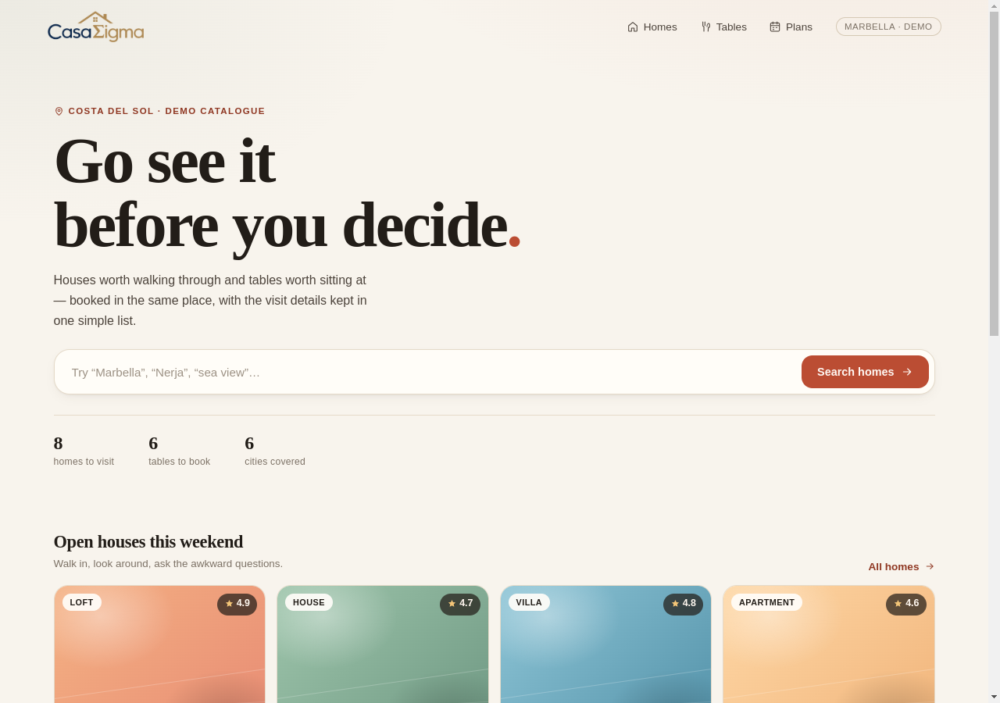
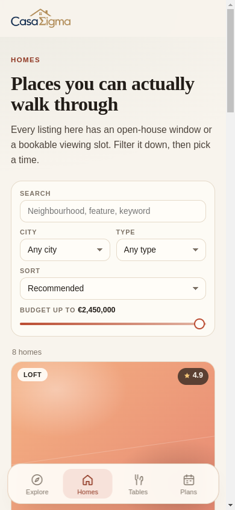

# CasaSigma

CasaSigma Real Estate on the **Costa del Sol** (Málaga, Andalusia): **houses to visit** and
**restaurants to buy** — freeholds, leases and traspasos. One React + TypeScript codebase ships as
a web app and as a Capacitor Android app, branded with the CasaSigma logo, and the brand artwork is
stored in Postgres.

This repository contains a **working MVP with demo data**: browsing, filtering, detail pages,
house viewing requests, restaurant sale listings, and buyer/seller accounts with session-backed
sign-in. No paid service required. The catalogue covers Marbella, Estepona, Málaga, Mijas, Casares
and Nerja.



## Can we build it here, for free?

Yes. Everything in the current stack is free and open source, and the machine already has what is
needed for the web app (Node 22, npm, Java 21, Android SDK, Gradle). Costs only appear later:

| Item | Cost |
| --- | --- |
| React, TypeScript, Vite, React Router | Free, MIT |
| Capacitor Android shell | Free, MIT |
| Android Studio / Android SDK | Free |
| Local development and testing | Free |
| Static hosting (Netlify / Vercel / Cloudflare Pages free tier) | Free for a demo |
| PostgreSQL (local cluster in `.pgdata`, or Supabase/Neon free tier) | Free |
| Account email login later (Supabase Auth free tier) | Free tier is enough for an MVP |
| Google Play developer account | **$25 one-time**, only when you publish |
| Apple App Store | **$99/year**, only if you add iOS later |

The only unavoidable cost in the first milestone is the Play Store fee if you want the app listed.
An APK can be installed on a phone from a file for testing at zero cost.

## Which language should we use — Python, TypeScript or React?

Short answer: **TypeScript + React for the app, and no Python for the MVP.** Add Python later only
if a specific job needs it (scraping listing feeds, price models, image processing).

| Option | Best at | Weak at | Verdict for CasaSigma |
| --- | --- | --- | --- |
| **TypeScript + React** | One codebase for web + Android WebView, typed UI, huge ecosystem, fastest iteration | Heavier runtime than plain JS; needs tooling | **Recommended.** The UI is the product; TypeScript prevents most booking/date bugs at compile time |
| Python (Django/FastAPI) | Data work, scraping, ML, scripts | Needs a separate frontend anyway; cannot run inside Capacitor | **Not as the app language.** Optional later for a recommendation/ingestion service |
| React Native | Native look on Android/iOS | Different codebase from the web app, native build complexity, slower start | Only if you later need native performance or device APIs |
| Plain HTML/CSS/JS | Zero tooling | No types, no components, painful at this feature size | Not for a product this size |

**React is a library, not a language.** React runs on JavaScript/TypeScript, so the real choice is
TypeScript vs Python. TypeScript wins here because the same code runs in the browser and inside the
Android package. A Python backend would mean building and hosting two systems before the first
feature works.

If the backend becomes data-heavy later, the natural split is: **TypeScript/React frontend +
Supabase (Postgres) or a small Python/FastAPI service for ingestion and ranking.** The frontend does
not need rewriting when that happens.

## Quick start

```bash
npm install
npm run setup      # Postgres cluster + brand images + demo accounts
npm run api        # terminal 2: API on http://127.0.0.1:8787
npm run dev        # terminal 3: http://localhost:5173
```

`npm run setup` creates two local demo accounts (`demo.buyer@casasigma.test` and
`demo.seller@casasigma.test`) and an admin with the username `admin2`. No password is stored in this
repository: set `DEMO_PASSWORD` and `ADMIN_STARTER_PASSWORD`, or leave them unset and the seed
script generates random ones and prints them once in the terminal.

The admin's first sign-in uses the starter password and lands on `/#/admin/credentials`, where you
choose your own username and password before the dashboard opens. The API refuses to keep the
password you signed in with. `npm run db:seed:users -- --reset-admin-password` gives the admin a new
starter password and signs it out everywhere. There is no Admin entry in the header or tab
bar: signing in opens `/#/admin`, and the route plus `/api/admin/*` answer `401`/`403` for everyone
else.

Browsing works without the API, but signing in and seller contact details need it. The logo falls
back to the bundled PNG in `public/brand/` when the API is down.

Other scripts:

```bash
npm run typecheck  # strict TypeScript, no emit
npm run build      # typecheck + production build into dist/
npm run preview    # serve the production build
npm run db:start   # start (or initialise) the project-local Postgres cluster
npm run db:stop    # stop it
npm run db:status  # is it running?
npm run db:seed    # copy public/brand/*.png into the media table
npm run db:seed:users  # create the demo accounts and the starter admin login
npm run api        # API (also applies db/schema.sql on boot)
npm test           # API tests (boots the API against the casasigma_test database) + web tests
npm run test:web   # web tests only (Vitest, no database needed)
```

`npm test` needs the local cluster running (`npm run db:start` also creates `casasigma_test`). To
use another database, set `TEST_DATABASE_URL`; its name must contain `test`, and the tests create
and delete their own accounts in it.

## Brand and the Postgres media store

The header wordmark is **not hard-coded**: the app requests `GET /api/media/brand-logo` and uses the
bundle only as a fallback. That keeps the brand editable in one place and gives listing photos the
same delivery path later.

| Asset | Slug | Source file |
| --- | --- | --- |
| Header wordmark (house + “CasaSigma”) | `brand-logo` | `public/brand/casasigma-wordmark.png` |
| Full lockup with “REAL ESTATE” | `brand-lockup` | `public/brand/casasigma-lockup.png` |
| Square house mark (favicon, launcher) | `brand-icon` | `public/brand/casasigma-icon.png` |

The artwork was cut from the supplied logo: white background removed, shadow band trimmed, and the
asset saved as transparent PNG so it sits on the cream page without a visible box.

**Data model** ([`db/schema.sql`](db/schema.sql)): `media(slug, mime, bytes bytea, updated_at)`, with
checks on the slug format, MIME type and an 8 MB ceiling.

**Photo size limits.** The API refuses a listing photo over **1 MB** and a profile portrait over
**512 KB** (`413`), whether or not the upload declares its length. Before uploading, the browser
([`src/lib/image.ts`](src/lib/image.ts)) re-encodes every photo as JPEG to fit: longest side at most
1600 px (listings) or 900 px (portraits), then lower quality, then smaller, until it is under the
limit. Re-encoding also drops EXIF data such as a phone's GPS position, and transparent PNG areas
become white. A typical 3–8 MB phone photo ends up around 200–400 KB; one that still cannot fit is
reported to the person instead of uploaded.

**API** ([`server/index.mjs`](server/index.mjs), no framework):

| Request | Result |
| --- | --- |
| `GET /api/health` | `{ ok, db: { time, media } }` |
| `GET /api/media` | metadata for every asset (no bytes) |
| `GET /api/media/:slug` | image bytes, `ETag` + `304`, 60 s browser cache |
| `PUT /api/media/:slug` | listing photos only (`listing-` slug), needs an account with selling permission; brand assets are seed-only |

**Replace the logo:** drop the new PNG over `public/brand/casasigma-wordmark.png`, run
`npm run db:seed`, reload. The size attributes in `src/components/BrandLogo.tsx` matter for layout
stability — update them if the aspect ratio changes.

**Why a local cluster?** `scripts/pg.sh` runs Postgres 18 on port 5434 with its data in `.pgdata`
(gitignored), so nothing needs `sudo` and no system database is touched. Point `DATABASE_URL` at a
hosted Postgres when you deploy; the app code does not change.

**Trade-off, stated plainly:** images in `bytea` are ideal for a dozen brand marks and thumbnails,
and awkward for hundreds of megabytes of listing photography — that work goes to object storage
with only the URL kept in Postgres.

### Sharing a hosted Postgres (Render)

CasaSigma can live inside another app's database — for example the ICMBOT Postgres on Render — so
a test deployment needs no second paid database. Its tables go in a `casasigma` schema, and it
connects with a login that has no rights on the other app's tables.

1. As the database owner, from a terminal, run the one-time setup with the **External Database
   URL** from the Render dashboard. It creates the `casasigma` schema and the `casasigma_app` login,
   then asks for that login's password (not echoed, never written to a file). It is safe to run
   again.

   ```bash
   psql "<External Database URL>" -f db/shared-database-setup.sql
   ```

2. On the CasaSigma service, in the **same region** as the database, set:

   | Variable | Value |
   | --- | --- |
   | `DATABASE_URL` | the **Internal Database URL**, with `casasigma_app` and its password in place of the owner's user and password |
   | `DATABASE_SCHEMA` | `casasigma` |

On boot the API checks that the schema exists and that the login can use it, and refuses to start
otherwise, so a wrong URL never creates tables in the other app's `public` schema. The seed scripts
make the same check.

Things that come with sharing:

- **Resources are shared.** Both apps use the plan's RAM and connection limit. `casasigma_app` is
  capped at 10 connections, and the API pool uses at most 4.
- **Backups are shared.** Restoring the database to an earlier point rolls back both apps.
- **Unverified on Render:** the setup needs an owner that can create roles (`CREATEROLE`). It was
  rehearsed on a local Postgres 18 with a non-superuser owner, not on Render itself.
- **Moving out later** is one `pg_dump --schema=casasigma` into CasaSigma's own database; then
  unset `DATABASE_SCHEMA`.

### Test deployment on Render (`casasigma-test.onrender.com`)

One Render web service runs `server/index.mjs`, which serves both `/api` and the built web app from
`dist/` (`server/web.mjs`). Page and API share one origin, which the API needs: it rejects
cross-origin writes and its session cookie is `SameSite=Lax`. Routes are hash-based (`/#/…`), so no
rewrite rule is needed. With `NODE_ENV=production` the API serves `dist/`; in development Vite does.

1. **Database:** run the shared-database setup above against the ICMBOT database, and note its
   region.
2. **New → Web Service**, connect the `casasigma` repository, then:

   | Setting | Value |
   | --- | --- |
   | Name | `casasigma-test` (the URL is `https://<name>.onrender.com`; if the name is taken Render adds a suffix) |
   | Branch | `casasigma-postgres` |
   | Region | **the same region as the ICMBOT database** |
   | Runtime | Node |
   | Build command | `npm ci --include=dev && npm run build` |
   | Start command | `npm run api` |
   | Instance type | Free is enough for a test (it sleeps when idle) |
   | Health check path | `/api/health` (under Advanced) |

   `--include=dev` matters: with `NODE_ENV=production` set, a plain `npm ci` skips TypeScript and
   Vite and the build fails.

3. **Environment variables:**

   | Variable | Value |
   | --- | --- |
   | `NODE_VERSION` | `22` |
   | `NODE_ENV` | `production` |
   | `API_HOST` | `0.0.0.0` |
   | `API_PORT` | `10000` (Render's default `PORT`) |
   | `COOKIE_SECURE` | `1` |
   | `APP_ORIGIN` | `https://casasigma-test.onrender.com` (the service's real URL, if Render changed the name) |
   | `DATABASE_URL` | the ICMBOT database's **Internal Database URL** with `casasigma_app` and its password |
   | `DATABASE_SCHEMA` | `casasigma` |

   Without `RESEND_API_KEY` and `MAIL_FROM`, production sends no email; that is fine for a test.

4. **Deploy.** The log should end with `media API on http://0.0.0.0:10000 (…, schema: casasigma,
   web: …/dist)`, and `https://casasigma-test.onrender.com/api/health` should answer `ok: true`.

5. **Demo accounts and brand images**, once, from your own machine. A free instance has no Render
   shell, so the seed scripts run locally against the **External Database URL** (with
   `casasigma_app`, plus `?sslmode=require`). `read -rs` keeps the passwords out of the shell
   history:

   ```bash
   read -rs DEMO_PASSWORD && export DEMO_PASSWORD
   read -rs ADMIN_STARTER_PASSWORD && export ADMIN_STARTER_PASSWORD
   read -rs DATABASE_URL && export DATABASE_URL
   DATABASE_SCHEMA=casasigma NODE_ENV=production npm run db:seed
   DATABASE_SCHEMA=casasigma NODE_ENV=production npm run db:seed:users
   ```

   The admin then signs in as `admin2` with the starter password and chooses its own credentials.

## Accounts and sessions

Buyers and sellers have real accounts. Passwords are hashed with Node's `scrypt`, and a sign-in
creates an opaque session whose **SHA-256 hash** is the only thing stored in Postgres. The browser
holds the raw token in an `HttpOnly`, `SameSite=Lax` cookie (`cs_session`, 30-day sliding expiry),
so no credential is reachable from JavaScript.

| Request | Purpose |
| --- | --- |
| `POST /api/auth/signup` | name, email, password, role (`buyer` or `seller`) → account + session |
| `POST /api/auth/login` | email **or** admin username + password → session; `401` is deliberately uniform |
| `POST /api/auth/admin-credentials` | signed-in admin only: current password + new username/password → replaces the starter credentials; `401` for a wrong current password, `400` for an invalid username/password, `409` for a taken username |
| `POST /api/auth/forgot` | `{ email }` → `202` for any well-formed address; mails a single-use reset link when the account exists |
| `POST /api/auth/reset` | `{ token, password }` → replaces the password, burns the token and deletes every session for that account; `400` with `field: token` for an expired or reused link |
| `POST /api/auth/logout` | delete the session row and clear the cookie |
| `GET /api/auth/me` | the signed-in user, or `401` |

Guardrails in the API: cross-origin writes are rejected (`403`), failed logins are limited to five
per email and IP per 15 minutes (`429`), emails are unique case-insensitively, and media uploads
need an account with selling permission and a `listing-` slug so the seeded brand marks cannot be
replaced. In production, `npm run db:seed:users` refuses to create demo accounts unless
`DEMO_PASSWORD` is set.

### What a guest sees

Browsing is behind a sign-in wall. Signed-out visitors get the layout of the catalogue with every
card's photograph blurred and its copy unreadable, plus a **Login required** pill; the card itself
links to `/login?next=<page>`. `/homes/:id`, `/restaurants/:id` and `/listings/:id` render a blurred
cover with a sign-in panel instead of the gallery, price, address, menu or booking form. Signing in
returns the person to the page they wanted.

The wall is not only cosmetic: `GET /api/listings`, `GET /api/listings/:id` and `GET
/api/media/listing-*` answer `401` without a session, so seller listings and their photographs are
never downloaded by a guest. Brand marks and approved profile portraits stay public because the
sign-in and profile screens need them. The demo catalogue itself is bundled in the JavaScript, so
its blur is presentation only.

### Forgotten passwords

`/#/forgot` takes an email address and mails a link to `/#/reset?token=…`. Nothing is ever mailed
in plain text: the token is 32 random bytes, only its **SHA-256** is stored in `password_resets`,
it works once, and it expires after an hour. Redeeming it also deletes every session for the
account, so a password that leaked stops working everywhere. The endpoint answers `202` for any
well-formed address — known or not — so the form cannot be used to discover who has an account,
and requests are limited to five per IP per hour.

Email (password resets, and the two mails for a viewing request: one to the seller, one to the
visitor) goes through `sendMail()` in `server/mail.mjs`. With [Resend](https://resend.com) set:

| Variable | Purpose |
| --- | --- |
| `RESEND_API_KEY` | API key from https://resend.com/api-keys |
| `MAIL_FROM` | sender on a domain verified in Resend, e.g. `CasaSigma <no-reply@casasigma.com>` |
| `APP_ORIGIN` | public origin for links in emails, e.g. `https://casasigma.com`. **Required in production**: links never come from `Host` or `X-Forwarded-Host`, and without `APP_ORIGIN` a production server skips reset emails. On a developer machine the page's own `Origin` is used when it is localhost, otherwise `http://localhost:5173` |

Without `RESEND_API_KEY` and `MAIL_FROM`, outside production, every mail is written as an `.html`
and a `.txt` file to `.mail-outbox/` (git-ignored; `MAIL_OUTBOX_DIR` changes the folder), which is
how the flows are exercised locally. With `NODE_ENV=production` and no Resend settings nothing is
sent. The log names the kind of mail, never the address or the text. A mail failure never changes
the response, so an outage cannot be told apart from an unknown address.

## Admin dashboard

The admin signs in as **`admin2`** with the starter password printed by the seed script, then must
replace both username and password on `/#/admin/credentials` before `/#/admin` opens. Admins are recognised
by username, buyers and sellers by email, and one login field accepts either. The same page is the
change-password screen later on — reachable from the dashboard. Signing in opens `/#/admin`, the
header (and the phone tab bar) swaps the seller studio for an **Admin** entry so the dashboard is
one tap away, and `/#/profile` redirects there because an admin has no public profile. The API is
the real guard regardless of the UI.

Sign up picks a role (`buyer` or `seller`), and that role sets two flags, `can_buy` and `can_sell`,
which every request re-reads with the session. **`/#/admin`** is the account desk on top of that: it
lists every account that signs up and lets an admin suspend or delete it.

| Action | Effect |
| --- | --- |
| Suspend | Sets `suspended_at` and deletes that account's sessions; sign-in then fails with `403 This account is suspended` |
| Reactivate | Clears `suspended_at`; the account can sign in again and keep its role |
| Delete | Removes the row for good; sessions cascade, and the email can sign up again |

| Request | Purpose |
| --- | --- |
| `GET /api/admin/users?q=` | accounts plus totals (`total`, `buyers`, `sellers`, `admins`, `suspended`); admins only |
| `PATCH /api/admin/users/:id` | `{ suspended: boolean }`; admins only |
| `DELETE /api/admin/users/:id` | permanent account deletion; admins only |

Signup-derived flags still gate behaviour: `PUT /api/media/listing-*` answers `403 selling
permission is not enabled for this account` when `can_sell` is false, and the restaurant contact
panel replaces phone and email with a “buying is turned off” notice when `can_buy` is false.
Suspension is the broader switch — a suspended account cannot sign in at all, so it can do neither.

### Cities, listings, viewing requests and profiles

| Request | Purpose |
| --- | --- |
| `GET /api/cities` | every town in `cities` with its published-listing count; the city filter reads this |
| `GET /api/listings` | live listings, newest first (`?mine=1` for the signed-in seller) |
| `GET /api/listings/:id` | one published listing with its photos, for `/#/listings/:id` |
| `POST /api/listings` | seller or admin: title, kind, city, price, description → upserts `cities`, inserts `listings` |
| `POST /api/listings/:id/photos?slot=1…5` | raw image bytes → `media` (`listing-*` slug) and that photo slot; replacing a slot deletes the old file |
| `DELETE /api/listings/:id/photos/:slot` | removes one photo and its bytes; the other slots keep their numbers |
| `POST /api/viewings` | the `/book` contact form; guests allowed, signed-in requests get `user_id` |
| `GET /api/viewings` | the signed-in account's requests, by visit date |
| `PATCH /api/viewings/:id` | `{ status: 'Cancelled' }` for the owner |
| `GET /api/profile` | the signed-in account's profile, including its own pending portrait |
| `PUT /api/profile` | name, phone, company, looking-for, bio; buyers and sellers only |
| `POST /api/profile/photo` | raw image bytes → `media` (`profile-*` slug), status `pending`, old portrait removed |
| `GET /api/profiles` | approved portraits only, for the home-page people strip |
| `GET /api/admin/photos` | the whole queue, pending first; admins only |
| `PATCH /api/admin/photos/:id` | `{ status: 'approved' \| 'rejected' }`; admins only |

`publicProfile()` never hands a portrait slug to a browser unless the owner is asking or an admin
has approved it, so hiding an unapproved photo is a server rule, not a CSS trick. Requests are
validated server-side (email, date, time, price, list membership) and towns are compared through a
`lower(name)` unique index, so `nerja` and `Nerja` are the same city.

Authorisation is server-side: these endpoints answer `401` without a session and `403` for anyone
whose role is not `admin`. The page shows a 403 card rather than pretending the area exists, and the
header nav only advertises the link to admins. Your own row and every admin row are read-only
(`409` from the API), so one bad click cannot lock every admin out. The only way to make an account
an admin today is the seed script or SQL — deliberate, to keep privilege escalation out of the UI.

## Android (Capacitor)

The native project is already generated in [`android/`](android/). After changing web code:

```bash
npm run android:sync   # build web + copy assets into the Android project
npm run android:open   # open Android Studio
```

Or from the command line with an emulator/device attached:

```bash
adb devices
npm run android:run
```

To build a debug APK without opening Android Studio (needs `ANDROID_HOME` set):

```bash
export ANDROID_HOME="$HOME/Android/Sdk"
cd android && ./gradlew assembleDebug
# android/app/build/outputs/apk/debug/app-debug.apk
```

This build was verified in this workspace: `BUILD SUCCESSFUL`, 4.2 MB debug APK containing the
current brand assets. Installing it needs an emulator or a phone with USB debugging — neither was
available here, so the APK has not been launched on a device yet.

Notes:

- The web build uses `base: './'` and `HashRouter`, so deep links work inside the Android WebView
  which serves the app from `https://localhost`.
- The app id is `app.casasigma.mobile` and the launcher label is `CasaSigma`; the id cannot change
  after the first Play upload, so decide on it now.
- The launcher icon, adaptive icon, splash screens and background colour are generated from the
  brand mark (cream `#F8F4ED` + gold house). Release signing is still open.

## What works today

- **Explore** — search entry point, curated open houses and restaurants for sale.
- **Homes** — filter by keyword, city, property type, budget; sort by price, size or rating.
- **Home detail** — facts, amenities, host card, open-house window, 7-day viewing picker.
  Booking validates name/time, blocks taken slots, and shows a confirmation.
- **Restaurants** — freeholds, leases and traspasos; filter by cuisine, city and keyword, sort by
  price or seats. The old `/tables` links redirect here.
- **Restaurant detail** — asking price, tenure, seats, hours, what comes with the room and the
  seller. Contact details unlock once a buyer signs in.
- **Accounts** — sign up as a buyer or a seller, sign in and out; the session is an `HttpOnly`
  cookie backed by Postgres, not a token in `localStorage`.
- **Admin** — the first sign-in uses the starter password and opens a credentials step to choose
  your own username and password; `/#/admin` (no menu entry) then lists every account: totals,
  search, and suspend / reactivate / delete, with an inline confirmation before deleting.
  Non-admins get a 403 card and the API refuses them. A **Profile photos** panel on the same page
  is the approval queue: the pending portraits with submitter, date and Approve / Reject.
- **Book** — the `/book` page (the old `/plans` link redirects) pairs a contact form — listing,
  name, email, what you want to see — with a calendar and time slots. Requests go to Postgres and
  the signed-in account sees and cancels them there. Viewings requested from a listing page are
  still saved on the device under `casasigma.store.v1` and listed below the account requests.
- **Seller studio** — signing in as a seller opens `/#/sell` directly, with the Homes tab next to
  it for browsing and search. The form publishes a listing (title, type, town, price, description)
  into `listings` and uploads up to five photos into the fixed slots 1–5; slot 1 is the cover.
  Published listings keep editable photo slots under “Your listings”. The town is upserted into
  `cities`, so a new place becomes a filter option for every buyer; `/#/homes` reads that table and
  shows the new listings under “Just listed”, each linking to `/#/listings/:id` with the gallery and
  a “Request a viewing” link into `/book`.
- **Profiles** — buyers and sellers fill in `/#/profile` (name, phone, company or what they are
  looking for, a short bio) and upload a portrait. The photo is stored in `media` and stays hidden
  until an admin approves it; approved portraits appear on the home page.
- **Languages** — English, Spanish, Dutch and Danish across every screen. The header `EN ES NL DA`
  pill switches language, the choice persists in `localStorage`, and `<html lang>` follows it.
- **Footer** — every route ends with the brand, section links, “© 2026 CasaSigma” and a rights line.
- **Brand** — the header logo comes from Postgres through the media API, with a bundled fallback.



Demo content is deliberately small but local: 8 homes across 6 Costa del Sol towns (Marbella,
Estepona, Málaga, Mijas, Casares, Nerja) and 6 restaurants in 5 of them, three freehold and three
traspasos. Prices are in euros, agents and sellers use Spanish mobile numbers, and the listing copy
is Andalusian rather than generic. The data lives in [`src/data/`](src/data/); listing ids are stable
so bookings already saved on a device keep resolving after copy changes.

## Project structure

```
src/
  components/    Layout, footer, language switcher, brand logo, cards, pickers, artwork, icons
  data/          Seed houses and restaurants (replace with an API later)
  i18n/          Message catalogue for en / es / nl / da
  lib/           Formatting, localStorage bookings, media fetcher, auth API client
  pages/         Route-level screens, including login/signup and the admin dashboard
  state/         Language, auth session and viewing-request providers
  types.ts       Domain types shared by every screen
server/          API (Node http + pg): auth, media, no framework
scripts/         Local Postgres lifecycle, media and demo-account seeding
test/api/        API tests (node:test), each file boots its own server
test/web/        Frontend tests (Vitest + jsdom)
db/              SQL schema for media, users, sessions, cities, listings, listing photos, requests and profiles
public/brand/    Logo source files (also served as the offline fallback)
android/         Generated Capacitor Android project
```

## Known limitations

- Viewings requested from a listing page are still device-only; only `/book` requests reach
  Postgres. Clearing site data or reinstalling loses the device list.
- The seller studio cannot edit a published listing's text, reorder the cover or delete a listing
  yet; only its photos can be changed after publishing.
- Listing photos appear publicly as soon as they are uploaded — unlike profile portraits, there is
  no admin approval queue for them.
- Profile photos are capped at 512 KB by the API and compressed in the browser first. There is no
  moderation history beyond the current status.
- Restaurant interest is a direct call or email after sign-in; there is no stored enquiry thread yet.
- Sessions are cookie-based and therefore not yet verified inside the Capacitor WebView.
- Slots are fictional; no availability service is contacted.
- Catalogue cards still use generated gradient artwork; seller-published listings show their own
  uploaded photos. Page headers and sign-in panels use brand-coloured backgrounds: the site holds
  no third-party photos.
- Landing copy and listing prose stay in the language the seller wrote them in; the interface is
  translated, the catalogue is not.
- Brand assets live in Postgres on this machine; the Android build has no API and therefore always
  uses the bundled copies.
- Listing media upload is restricted to signed-in sellers but has no UI yet; profile photos do
  have one.
